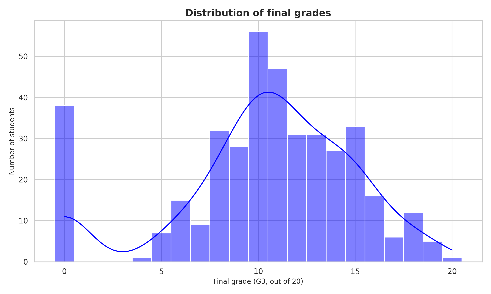
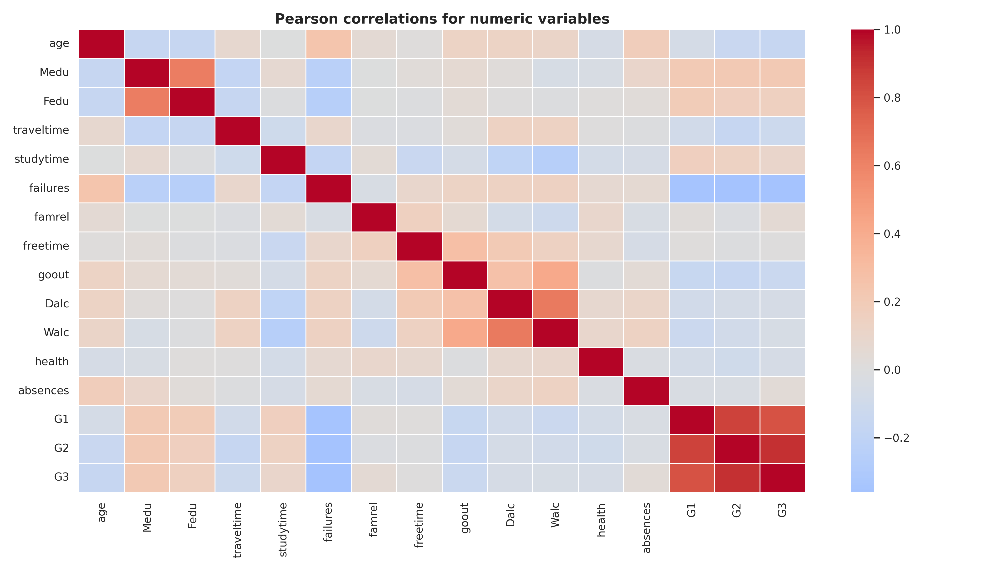

# Student Performance Analysis

This academic project explores patterns in Portuguese secondary school mathematics grades and uses multiple linear regression to predict the final course grade, `G3`, on a 0–20 scale.

## Dataset

The analysis uses `student-mat.csv` from the UCI Student Performance dataset by Paulo Cortez. It contains 395 mathematics records from two Portuguese schools, with 32 predictors covering demographics, school and family context, study habits, absences, and the first- and second-period grades (`G1` and `G2`). The Portuguese-language course file is outside the scope of this analysis. [UCI dataset and variable descriptions](https://doi.org/10.24432/C5TG7T)

## Exploratory analysis

The histogram shows 38 recorded final grades of zero. The data do not identify the reason for each zero or confirm whether a student withdrew. The regression treats them as recorded grades.



The Pearson correlation heatmap shows strong positive linear associations between the final grade and both period grades. The correlations with `G3` are 0.80 for `G1` and 0.90 for `G2`.



Multiple correspondence analysis (MCA) maps the categories of text fields into two dimensions. Nearby categories can suggest similar response profiles in this projection. The MCA excludes grades and has no dropout outcome. [Category map](docs/figures/category-map.png)

The script also exports a boxplot by higher education plans and a chart of mean grades by extra educational support and sex. These are descriptive comparisons. Correlations and group differences alone cannot establish cause and effect.

## Regression results

The model uses ordinary least squares with an 80/20 random split (`random_state=6`). It fits the numeric scaler and one-hot encoder on 316 training rows, then applies them to 79 test rows. The exploratory plots use the full dataset and are separate from model fitting.

| Test metric | Result | Interpretation |
|---|---:|---|
| RMSE | 2.1936 | Square root of the mean squared prediction error, in grade points. Larger misses count more. |
| R² | 0.7859 | Squared error is 78.59% lower than using the test set's mean grade as a constant reference. |

These scores describe predictions made when both `G1` and `G2` are already available. Their strong association with `G3` helps explain the scores. Using either grade before it is recorded would leak future information. The project does not estimate performance at the start of the school year or measure how much each grade improves prediction. Any earlier prediction would also need to check when other inputs, such as absences, were recorded.

The results come from one split of a small sample from two schools. Performance on other schools or cohorts is untested.

## Run locally

Use Python 3.12. From the repository root:

```bash
python3.12 -m venv .venv
source .venv/bin/activate
python -m pip install -r requirements.txt
```

Download the dataset from UCI, open the downloaded archive, and extract `student.zip` inside it. Place the semicolon-delimited `student-mat.csv` in `data/raw/`. [Download from UCI](https://archive.ics.uci.edu/dataset/320/student+performance)

```bash
python src/analysis.py
```

The command prints the test metrics and saves five figures in `output/`. To regenerate only the figures, run `python src/visualization.py`. Add `--show` to open the figures in a graphical session. The dataset and newly generated figures are ignored by Git.

## Repository structure

- `src/preprocessing.py` loads the data, splits the rows, and prepares the predictors.
- `src/visualization.py` generates the exploratory figures.
- `src/analysis.py` trains and evaluates the regression and runs the full analysis.
- `docs/figures/` contains selected figures from the verified run.
